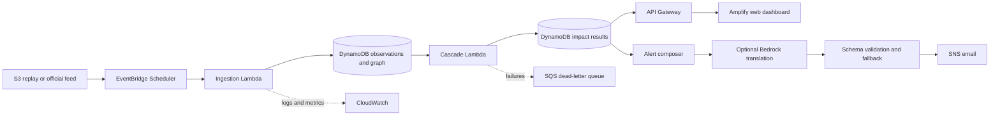

# Ripple

**Dependency-aware early warning for downstream water and essential-service disruption.**

Ripple converts a flood or river-level trigger into an explainable chain of likely downstream impacts. Instead of stopping at *"the river is rising"*, it answers:

- Kaunse water treatment plants risk mein hain?
- Kaunse supply zones aur essential facilities next affect ho sakte hain?
- Impact kitne time mein arrive ho sakta hai?
- Alert ka reason, source aur confidence kya hai?

Ripple is being designed for the **Heat and Water** track of [Environmental Hacks](https://www.wemakedevs.org/aws/env), part of the Bharat Builds Tour.

> [!IMPORTANT]
> This repository includes an interactive frontend, deterministic cascade engine, validated replay and graph contracts, bilingual advisory fallback, explainable shortage-risk baseline, Lambda handlers, tests, and AWS SAM infrastructure. The AWS stack and live data feed are not yet deployed or operationally verified. Track evidence in [PROJECT_STATUS.md](PROJECT_STATUS.md).

## The problem

Existing flood forecasts primarily describe the hazard: river level, rainfall, warning category, or inundation. Operational teams also need to understand the *consequences* of that hazard. A flooded pumping station can reduce a treatment plant's capacity; that can affect water-supply zones; hospitals and clinics in those zones may then need tankers or contingency staffing.

Ripple models this dependency chain and produces a traceable advisory:

```text
River gauge threshold crossed
        ↓
Water treatment plant at risk
        ↓
Supply zone faces capacity loss
        ↓
Hospital receives an early advisory
```

## Proposed hackathon demo

The primary scenario replays the July 2023 Yamuna flood in Delhi. A timestamped river-level event triggers a small, transparent dependency graph covering one river, three treatment plants, selected supply zones, and a few demonstration facilities.

The demo should show:

1. The recorded gauge observation and its source.
2. The cascade engine calculating earliest impact time and severity.
3. A map and timeline of affected entities.
4. A bilingual advisory with a deterministic fallback.
5. A **Why this alert?** view showing the full causal path and assumptions.

## AWS architecture



Bedrock is not part of the risk calculation. The cascade engine deterministically produces entities, times, severity, confidence, and action codes. Bedrock may only simplify or translate that validated result.

## Repository map

```text
.
├── backend/                 Deterministic domain core and Lambda handlers
├── data/                    JSON Schemas, replay fixtures, graph, and provenance
├── docs/                    Detailed product and engineering documentation
├── frontend/                Interactive operator and public advisory prototype
├── infrastructure/          AWS SAM deployment definition
├── ml/                      Shortage prediction model card and evaluation gates
├── CONTRIBUTING.md
├── PROJECT_STATUS.md
├── SECURITY.md
└── README.md
```

## Documentation

- [Complete Hinglish project guide](docs/PROJECT_GUIDE_HINGLISH.md)
- [Formatted Hinglish project handbook](docs/Ripple%20Complete%20Project%20Guide%20Hinglish.docx)
- [Architecture and component boundaries](docs/ARCHITECTURE.md)
- [API contract](docs/API_CONTRACT.md)
- [Data, provenance, and assumptions](docs/DATA_AND_ASSUMPTIONS.md)
- [Demo and submission plan](docs/DEMO_AND_SUBMISSION.md)
- [Delivery roadmap](docs/ROADMAP.md)

## Run the frontend

Requirements: Node.js 20+ and pnpm.

```bash
cd frontend
pnpm install
pnpm dev
```

Open the local URL shown by Vite. For a production check:

```bash
pnpm build
```

The deployed frontend is available at [ripple-topaz.vercel.app](https://ripple-topaz.vercel.app/). It remains in labelled local-replay mode until `VITE_API_BASE_URL` is configured with a deployed AWS API.

## Run the deterministic backend

Python 3.14 is used by the SAM template. The core has no third-party runtime dependency.

```bash
python -m unittest discover -s backend/tests -t backend -v
python -m backend.ripple.replay data/samples/yamuna-2023-replay.json data/samples/delhi-water-demo-graph.json
```

The replay regression produces three explainable facility impacts at 38, 72, and 125 minutes. All route delays and confidence weights are explicitly marked as demonstration assumptions.

## Shortage prediction

Ripple now has a `ShortagePredictor` interface and an explainable pre-ML baseline using reserve hours, supply, demand, river rise, upstream disruption probability, criticality, and prediction horizon. It makes UI/API integration testable today, but returns `productionReady: false` because no real labelled facility dataset has been supplied. The training target, leakage controls, event-based split, calibration checks, and safety gates are documented in [ml/MODEL_CARD.md](ml/MODEL_CARD.md).

### Implemented frontend experience

- Water-basin hero with animated river flow and live level instrument
- Controlled five-step historical replay
- Interactive dependency surface from gauge to critical facilities
- Hydrograph, event log, severity, confidence, and data-source labels
- Facility-specific **Why this alert?** causal trace
- English/Hindi advisory mode and deterministic action copy
- Dark/light theme, keyboard-accessible controls, reduced-motion support, and responsive layouts

The current scenario is a labelled frontend demonstration. Values are local sample data and must not be interpreted as a live or official warning.

## MVP acceptance criteria

The hackathon MVP is complete only when:

- A recorded event can be replayed end to end.
- Every generated alert has a visible causal path.
- The cascade calculation finishes in under one second for the demo graph.
- No generated text can change engine-produced facts or numbers.
- Email delivery succeeds for a verified demonstration recipient.
- Failure cases, stale data, and unknown dependencies are visibly labelled.
- The deployed URL and three-minute demo work without local developer setup.

## Responsible-use boundary

Ripple is a decision-support prototype, not an official public-warning authority. Demonstration data and inferred dependencies must be labelled. Mass notification must require an authorised human approval step. The project must not store individual staff home addresses or other unnecessary personal data.

## Contributing

Read [CONTRIBUTING.md](CONTRIBUTING.md) before opening a pull request. Security-sensitive findings should follow [SECURITY.md](SECURITY.md).

## License

No license has been selected yet. Until the project owner adds a license, normal copyright restrictions apply.
