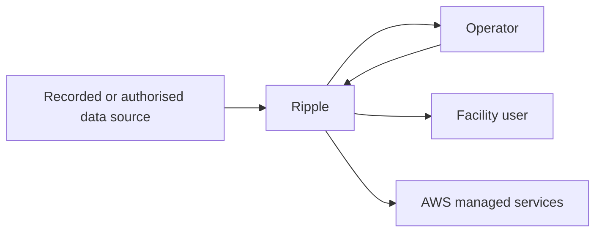
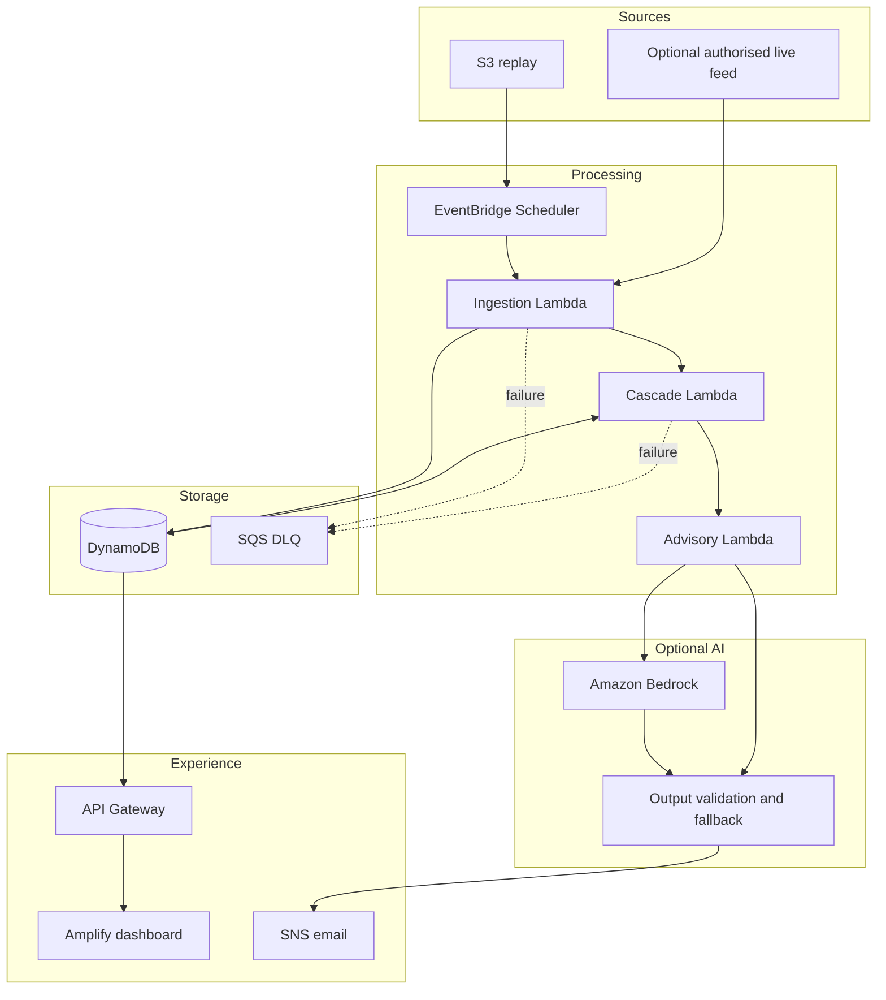

# Architecture

## Status

This is the target MVP architecture. It is not yet verified as deployed. Keep this document synchronized with the actual infrastructure once implementation begins.

## System context

## Container view

## Component responsibilities

| Component | Owns | Must not own |
|---|---|---|
| Ingestion | Source validation, normalisation, deduplication | Impact prediction |
| Cascade engine | Graph propagation, path, severity, confidence | Natural-language invention |
| Advisory composer | Locked fact object and templates | Changing calculated facts |
| Bedrock integration | Optional simplification or translation | Trigger or severity decisions |
| API | Authorised reads and controlled actions | Direct database logic in clients |
| Dashboard | Visualisation and approval workflow | Recalculating backend results |
| SNS | Delivery to verified recipients | Deciding recipients or impact |

## DynamoDB access patterns

Keep access patterns explicit before selecting a physical table design:

- Fetch event and ordered observations
- Fetch graph by version
- Fetch run summary by run ID
- Fetch impacts by run and expected time
- Fetch explanation by impact ID
- Fetch alert and delivery audit by run

For the small MVP, one or a few purpose-built tables are acceptable. Do not force a single-table design unless the team can test and explain it.

## Reliability

- Use idempotency keys for replay observations.
- Configure bounded retries and DLQs for asynchronous functions.
- Persist calculation input and graph version with every run.
- Fail closed when schema version is unknown.
- Keep deterministic templates available when Bedrock is unavailable.
- Expose stale-data and partial-result states to the UI.

## Authentication and authorisation

- Public endpoints may read sanitised impact summaries.
- Replay, graph upload, approval, and notification endpoints require operator authentication.
- Use separate IAM roles for ingestion, cascade, API, and notification.
- No browser client receives direct DynamoDB permissions.

## Deployment

Use AWS SAM or CDK. A deployment should output:

- API base URL
- Dashboard URL
- Region
- Observation and result storage identifiers
- Replay bucket name
- Log group names

The infrastructure must also include a safe destroy procedure for hackathon resources.
